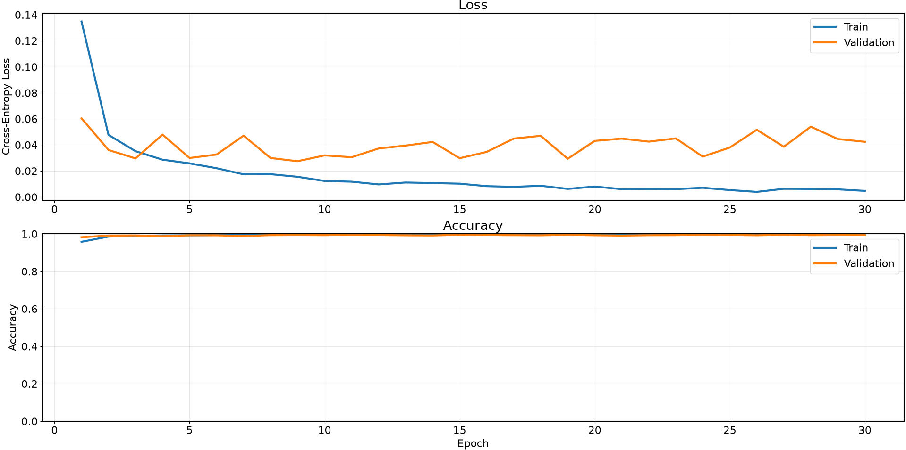
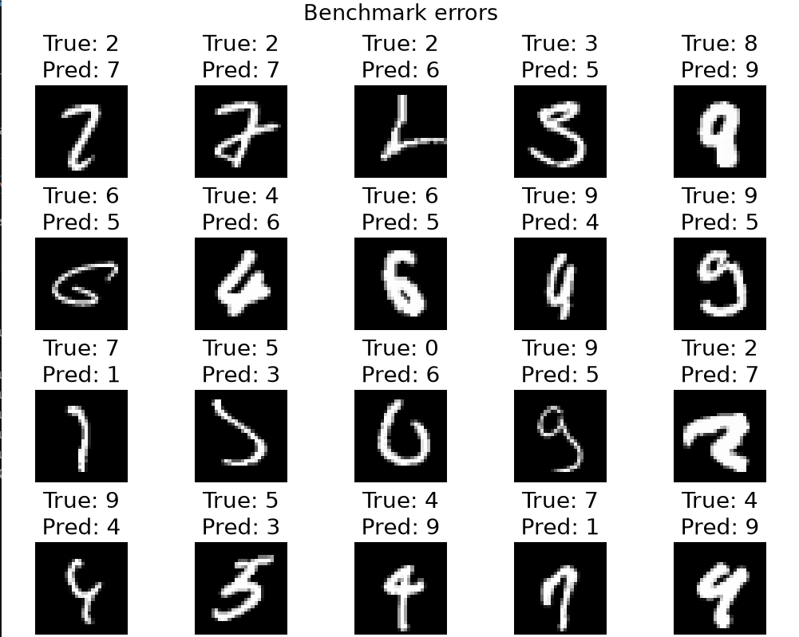

# MNIST — распознавание рукописных цифр

Учебный проект по ML. Основная цель -- классификация рукописных цифр MNIST с помощью CNN. 

В проекте реализована нейросеть с 4 сверточными и 2 полносвязными слоями. Обученная нейросеть может быть сохранена в файл, а затем быстро восстановлена по этому файлу. 
Много внимание уделено визуализации метрик обучения и результатов работы сети: можно посмотреть как меняет точность предсказаний в процессе обучения, на каких изображениях нейросеть чаще ошибается, можно даже проверить предсказания модели на собственных рисунках в простом графическом редакторе.

## Установка

Основные зависимости: `torch`, `torchvision`, `numpy`, `matplotlib`, `tqdm`. Для графического редактора также необходим Tkinter.

Все команды ниже запускаются из корня проекта.
```bash
python -m pip install -r requirements.txt
```

## Обучение — `train`



```bash
python run_train.py --device cpu --epoch 10 --model-dir model.pt --log-dir train.csv
```

Скрипт обучает нейросеть на train set MNIST, проверяет качество на validation set и сохраняет:

- `model.pt` — обученную модель;
- `train.csv` — историю Loss и Accuracy по эпохам.

Для обучения на GPU можно указать `--device cuda`.

| Параметр | Описание | По умолчанию |
|---|---|---|
| `--device` | Устройство для обучения: `cpu`, `cuda`, `cuda:0` | `cuda` |
| `--log-dir` | Путь к CSV файлу с метриками обучения | `train.csv` |
| `--model-dir` | Путь для сохранения весов модели | `model.pt` |
| `--val-set-size` | Количество изображений для валидации | `5000` |
| `--mnist-set-size` | Общий размер обучающей и валидационной выборок | `60000` |
| `--epoch` | Количество эпох обучения | `100` |

## Оценка модели — `benchmark`



```bash
python run_benchmark.py --device cpu --model-dir model.pt --train-log train.csv --num-errors 10
```

Скрипт загружает обученную модель, оценивает её на тестовой выборке MNIST и выводит Loss, общую Accuracy и точность по каждому классу.

Также строятся графики обучения по CSV-логу. Аргумент `--num-errors` задаёт количество ошибочных предсказаний для просмотра.


| Параметр | Описание | По умолчанию |
|---|---|---|
| `--device` | Устройство для вычислений | `cuda` |
| `--model-dir` | Путь к сохранённым весам модели | `model.pt` |
| `--train-log` | CSV файл с историей обучения для построения графиков | Не задан |
| `--log-dir` | Файл для записи результатов; без него вывод в терминал | Не задан |
| `--num-errors` | Количество ошибочных предсказаний для отображения | Не задано |

## Рисование цифр — `draw`


```bash
python run_draw.py --model-dir model.pt
```

Простой графический интерфейс на Tkinter позволяет нарисовать цифру мышкой, передать изображение обученной нейросети и получить её предсказание. Рисунок можно очистить и попробовать снова.

| Параметр | Описание | По умолчанию |
|---|---|---|
| `--model-file` | Путь к весам CNN (также `--model-dir`) | Не задан |
| `--device` | Устройство для вычислений | `cpu` |

## Дополнительно

Датасет MNIST загружается автоматически при первом запуске. Все доступные аргументы скриптов можно посмотреть через:

```bash
python run_train.py -h
python run_benchmark.py -h
python draw.py -h
```
